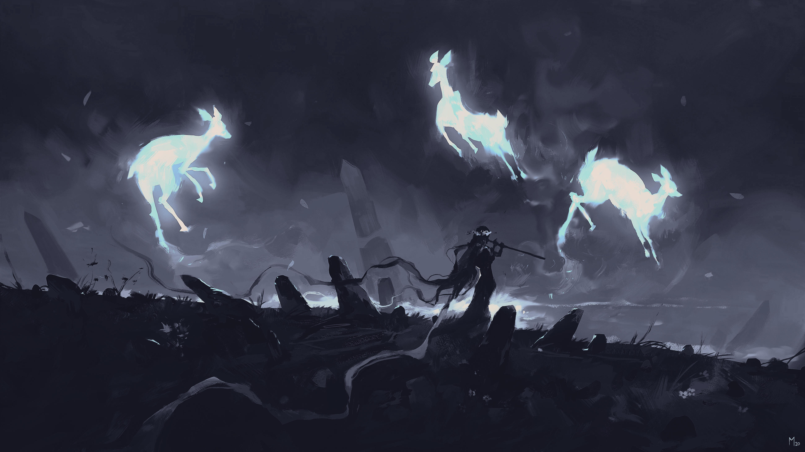
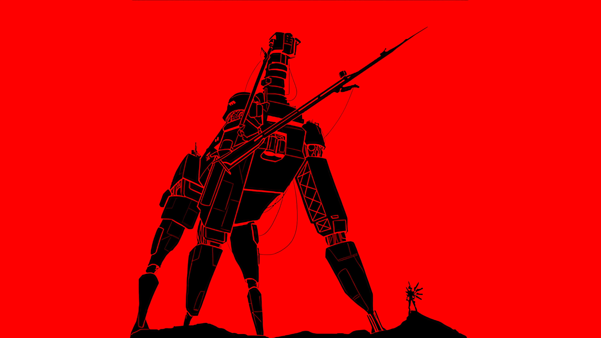

<div align="center">
  <h1>Evhyx Wallpaper Packages</h1>
  <p><strong>A personal, curated collection of static & live wallpapers.</strong><br>Organized in modular numbered packs for Wayland, Hyprland, and custom desktop setups.</p>
  <p><a href="#overview">Overview</a> &nbsp; / &nbsp; <a href="#preview">Preview</a> &nbsp; / &nbsp; <a href="#repository-structure">Structure</a> &nbsp; / &nbsp; <a href="#naming-convention">Naming Convention</a> &nbsp; / &nbsp; <a href="#usage">Usage</a></p>
</div>

---

## Overview

**A tailored wallpaper collection built for desktop personalization**

This repository contains a curated personal collection of wallpapers for desktop environments, tailored for Wayland and Hyprland configurations (such as [EvhOS](https://github.com/ItzEvhyx/EvhOS-Shell)). It brings together high-definition static wallpapers organized into numbered image packs and smooth animated live wallpapers (MP4 loops), ready for automated selectors, wallpaper switchers, or manual selection.

## Preview

A sample selection of wallpapers from across the collection:

| Image Pack 1 | Image Pack 2 |
| :---: | :---: |
|  |  |
| Minimalist vector art & aesthetic illustrations. | Thematic desktop backgrounds & gradients. |
| **Image Pack 3** | **Image Pack 4** |
|  |  |
| Catppuccin palettes & monochrome tones. | Stylized edits & pixel art landscapes. |
| **Image Pack 5** | **Collection Highlight** |
|  |  |
| Atmospheric scenery & nature backgrounds. | High-energy gaming & modern wallpapers. |

> [!NOTE]
> Looping live/video wallpapers are stored in the [`Videos/`](Videos/) directory as `.mp4` video files.

## Repository Structure

The repository separates static image backgrounds from looping video wallpapers to make integration seamless for wallpaper daemons:

```text
Evhyx_Wallpaper_Packages/
├── Pictures/    <-- 100 static wallpapers (Packs 1 to 5)
├── Videos/      <-- 8 live wallpapers (MP4 video loops)
└── README.md
```

| Directory | Type | Content | Total Items |
| :--- | :--- | :--- | :---: |
| **`Pictures/`** | Static Wallpapers (`.png`) | High-resolution image packs 1 through 5 | 100 images |
| **`Videos/`** | Live Wallpapers (`.mp4`) | Looping video wallpapers | 8 videos |

### Breakdown by Pack

| Pack | Type | Format | Items | Range |
| :--- | :--- | :--- | :---: | :--- |
| **Image Pack 1** | Static Wallpaper | PNG | 20 | `wallpaper_imagepack1_1.png` – `wallpaper_imagepack1_20.png` |
| **Image Pack 2** | Static Wallpaper | PNG | 20 | `wallpaper_imagepack2_1.png` – `wallpaper_imagepack2_20.png` |
| **Image Pack 3** | Static Wallpaper | PNG | 20 | `wallpaper_imagepack3_1.png` – `wallpaper_imagepack3_20.png` |
| **Image Pack 4** | Static Wallpaper | PNG | 20 | `wallpaper_imagepack4_1.png` – `wallpaper_imagepack4_20.png` |
| **Image Pack 5** | Static Wallpaper | PNG | 20 | `wallpaper_imagepack5_1.png` – `wallpaper_imagepack5_20.png` |
| **Live Pack 1**  | Live Wallpaper   | MP4 | 8  | `livewallpaper_lwpack1_1.mp4` – `livewallpaper_lwpack1_8.mp4` |

## Naming Convention

All wallpapers follow a uniform, index-based naming scheme tailored for shell scripts, CLI tools, and dynamic launchers (e.g. `rofi`, `fuzzel`, `wofi`, `quickshell`):

* **Static Wallpapers**: `wallpaper_imagepack<package-num>_<image-num>.png`
  * Example: `Pictures/wallpaper_imagepack3_1.png`
  * Standardized into packs of 20 images each.
* **Live Wallpapers**: `livewallpaper_lwpack<package-num>_<video-num>.mp4`
  * Example: `Videos/livewallpaper_lwpack1_1.mp4`

## Usage

These wallpapers can be integrated with various Wayland and X11 wallpaper managers:

### 1. Static Wallpapers (`swww` / `hyprpaper`)

**Using `swww`:**
```sh
# Set a static wallpaper with a smooth transition
swww img Pictures/wallpaper_imagepack1_1.png --transition-type wipe --transition-duration 2
```

**Using `hyprpaper`:**
```conf
# Inside hyprpaper.conf
preload = ~/Pictures/Wallpapers/Pictures/wallpaper_imagepack1_1.png
wallpaper = ,~/Pictures/Wallpapers/Pictures/wallpaper_imagepack1_1.png
```

### 2. Live Wallpapers (`mpvpaper`)

**Using `mpvpaper`:**
```sh
# Play a seamless video loop on a monitor (e.g. eDP-1)
mpvpaper -o "no-audio --loop" eDP-1 Videos/livewallpaper_lwpack1_1.mp4
```

### 3. Random Wallpaper Selector Script

A simple script to randomly select and apply a static wallpaper:

```sh
#!/usr/bin/env bash
WALLPAPER_DIR="$HOME/Pictures/Wallpapers/Pictures"
RANDOM_WALLPAPER=$(find "$WALLPAPER_DIR" -type f -name "*.png" | shuf -n 1)

swww img "$RANDOM_WALLPAPER" --transition-type fade
```

